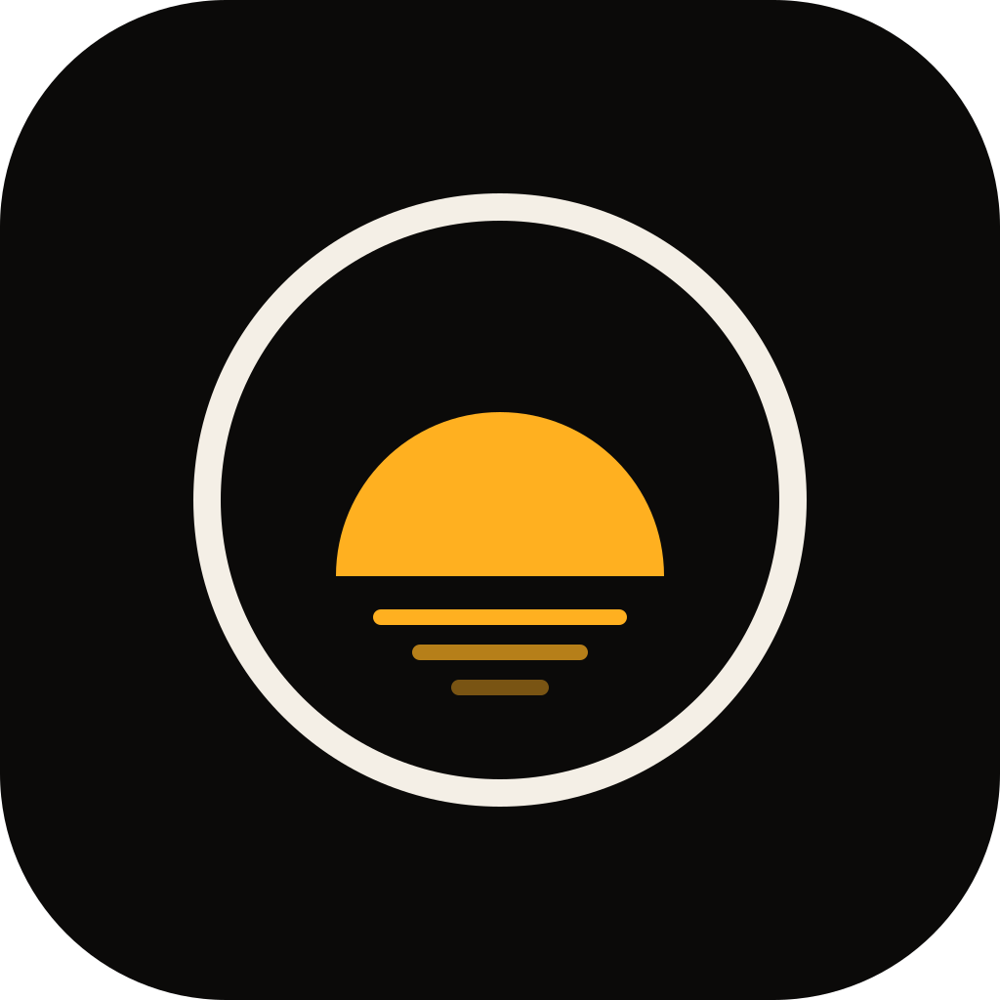

<p align="center">
  
</p>

<h1 align="center">Daybreak</h1>

<p align="center">
  An open-source pro camera and photo editor for Android.<br>
  It saves only modern formats: <b>JPEG XL</b> and <b>HEIC</b>.
</p>

<p align="center">
  
  
  
</p>

---

> **Status:** v0.2 "Pro": manual controls, HEIC, RAW + DNG, histogram and level, on top of v0.1's capture, JPEG XL saving, library and in-app updates. See the [roadmap](#roadmap).

## What works in v0.2

- Photo capture with tap to focus, pinch or tap zoom, grid, front and back camera
- **Pro mode**: manual ISO, shutter speed (1/8000 s to 30 s where the sensor allows), white balance presets and exposure compensation on ruler dials, with live readouts of what auto exposure chose, an exposure meter that balances manual ISO and shutter with one tap, and one-tap Auto
- **Focus modes**: Center (keeps focusing on the middle of the frame), Multi (the camera picks) and Manual (a distance dial from close-up to infinity)
- Photos saved as **HEIC** (hardware HEVC encoder, shows in every gallery; the default) or **JPEG XL** (quality 50–100, lossless, effort Fast / Balanced / Smallest) in `DCIM/Daybreak`
- **RAW + DNG** on cameras that support it: the DNG sits next to the photo and the library shows them as one
- Live **histogram** and a **level** that turns gold when the phone is straight
- The shutter never waits: photos encode in the background while you keep shooting
- Library grid with fast cached thumbnails, full-screen viewer with zoom, photo info and delete
- Share sends a temporary JPEG copy, because most apps can't open JPEG XL yet; RAW photos can also share their DNG
- **Pick Daybreak photos from other apps**: Daybreak appears in Android's file picker and in "choose a photo" requests, and the app receives a JPEG copy
- Photos keep the right way up even when you point the phone at the sky or the floor
- Updates itself from GitHub Releases: it checks once a day, downloads new versions on Wi-Fi and installs them when you tap Install (Settings › Updates)

Not in yet: the editor, HDR and Night, video and the other modes. They follow the roadmap.

## Why Daybreak

Phone cameras capture 10-bit color and HDR, then most apps throw it away by saving 8-bit JPEG. Daybreak keeps it:

- **HEIC** by default on phones with a hardware HEVC encoder: half the size of JPEG, and every gallery shows it.
- **JPEG XL** one tap away: smaller again at the same quality, with a true lossless mode, 10/16-bit color and HDR. Most gallery apps can't show it yet ([Fossify Gallery](https://github.com/FossifyOrg/Gallery) can), so Daybreak hands other apps a JPEG copy when they need one.
- **No JPEG in your library.** Share and the file picker get a temporary JPEG copy for that one use only.
- **Non-destructive editing.** Your original file is never changed.
- **No account, no ads, no tracking.** Everything stays on your phone.

## Features (planned for v1.0)

**Capture**
- Photo, Pro, Night, Portrait, Video and Scan modes
- Full manual control: ISO, shutter speed, focus, white balance
- RAW capture with DNG alongside the photo
- Live histogram, level, focus peaking and zebra highlights
- HDR and Night frame merging
- 4K HEVC 10-bit HDR video
- Document scanning to PDF and QR code reading

**Editor**
- Light, Color mixer, Curves, Detail, Crop and straighten
- Brush, linear and radial masks
- Presets you can save and share
- Undo, redo and hold-to-compare
- Video trim, speed and mute

**Library**
- Fast grid with format badges, albums, search and multi-select
- Photo info: ISO, shutter, aperture, lens, format and file size
- Share sheet that converts to JPEG or PNG when needed

## Tech stack

| Layer | Choice |
| --- | --- |
| UI | Kotlin + Jetpack Compose |
| Camera | CameraX with Camera2 interop |
| Image engine | C++23 via JNI, built with CMake + Clang (Android NDK) |
| GPU | Vulkan compute |
| JPEG XL | [libjxl](https://github.com/libjxl/libjxl) |
| HEIC | Android hardware HEVC encoder via HeifWriter |
| Data | Room (SQLite) and DataStore |

The C++ engine has no Android dependencies outside its JNI and platform folders, so it builds and runs its tests on a desktop too.

## Building

You need:

- Android Studio (current stable) or the Android SDK command-line tools
- JDK 17 or newer
- Android NDK r30
- CMake and Ninja (installed through the SDK Manager)

```bash
git clone https://github.com/AbdifatahWebDev/Daybreak-camera.git
cd Daybreak-camera
./gradlew assembleGithubDebug
```

The first build downloads libjxl 0.12 (and its highway, brotli and skcms parts) from GitHub through CMake, so it needs internet access and takes a few minutes.

The debug APK lands in `app/build/outputs/apk/github/debug/`. It installs beside a release build as `com.brekwol.daybreak.debug`.

There are two builds of the app:

| Build | For | Updates |
| --- | --- | --- |
| `github` | The APK on GitHub Releases | Updates itself from this repository's releases |
| `store` | Google Play and F-Droid | Left to the store. No updater and no internet permission |

A fork can point the updater at its own releases with `-PdaybreakUpdateRepo=owner/repo`.

### Native engine tests on a desktop

```bash
cmake -S native -B build-native -G Ninja -DCMAKE_BUILD_TYPE=Debug \
  -DDAYBREAK_BUILD_TESTS=ON -DDAYBREAK_SANITIZE=ON
cmake --build build-native
ctest --test-dir build-native
```

## Project structure

```
app/                 Screens (capture, library, viewer, settings) and data (MediaStore, DataStore)
core/designsystem/   Daybreak colors, type, fonts, icons and shared components
core/engine/         Kotlin API over the native engine
native/              C++23 engine: libjxl codec, EXIF, resizing, JNI bridge, tests
docs/                Assets and notes
```

More modules (camera, editor, and so on) split out as the app grows.

## Roadmap

| Release | Scope |
| --- | --- |
| v0.1 First light | Photo capture, JPEG XL saving, library grid and viewer |
| v0.1.1 | In-app updates from GitHub Releases |
| v0.2 Pro | Manual controls, RAW + DNG, HEIC, histogram, level (done) |
| v0.3 Editor | Vulkan editor: Light, Color, Curves, Detail, Crop, presets, share sheet |
| v0.4 Modes | HDR, Night, Portrait, Scan, video recording and trim |
| v0.5 Library+ | Albums, search, multi-select, masks, landscape and tablet layouts |
| v1.0 | Accessibility, translations, release on F-Droid and Google Play |

## Releases

The version lives in the `VERSION` file. Changing it on `main` builds the APK on GitHub Actions, then creates the tag and the GitHub release:

```bash
echo 0.2.0-rc.1 > VERSION   # pre-release (any version with a suffix)
echo 0.2.0 > VERSION        # release
git commit -am "Daybreak 0.2.0" && git push
```

Pushing a `v*` tag yourself works too.

Releases are signed with the key stored in these repository secrets (Settings › Secrets and variables › Actions): `DAYBREAK_KEYSTORE_BASE64`, `DAYBREAK_KEYSTORE_PASSWORD`, `DAYBREAK_KEY_ALIAS`, `DAYBREAK_KEY_PASSWORD`. Without them the APK is signed with a temporary key and marked as a test build.

The **Checks** workflow (engine tests under sanitizers, debug build, unit tests) runs only when started by hand from the Actions tab.

## Contributing

Daybreak is in early development, so please open an issue before starting a larger change. Bug reports with your phone model and Android version are very welcome.

Builds run on GitHub Actions only when the version changes or when started by hand, not on every push.

## Privacy

Daybreak works fully offline. It has no account, no analytics and no ads, and your photos never leave your phone unless you share them. Location tagging is off until you turn it on.

The only thing that goes online is the updater in the GitHub build. Once a day it asks `api.github.com` for this repository's releases and downloads a new APK from GitHub when there is one. It sends nothing about you or your photos. You can turn it off in Settings › Updates, and the store build doesn't include it.

## License

Daybreak is free software under the [GNU General Public License v3.0 or later](LICENSE).

Third-party code keeps its own license, including:

- [libjxl](https://github.com/libjxl/libjxl): BSD-3-Clause
- [Inter Tight](https://github.com/googlefonts/inter-tight) and [JetBrains Mono](https://github.com/JetBrains/JetBrainsMono): SIL Open Font License 1.1 (see `third_party/fonts/`)

---

<p align="center">Made by Abdifatah · <a href="https://brekwol.com">Brekwol</a></p>
